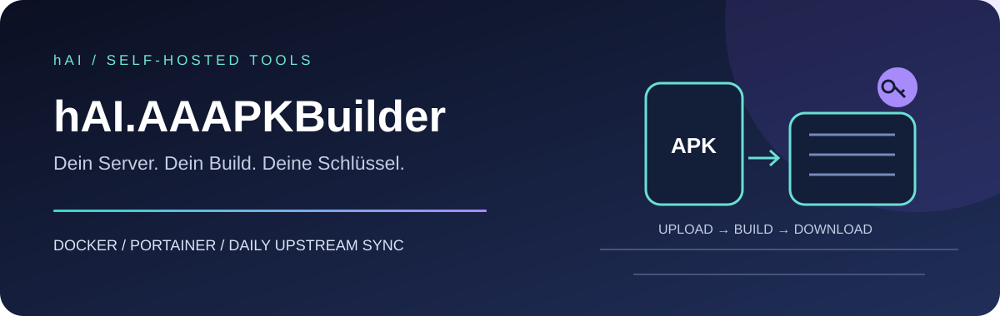
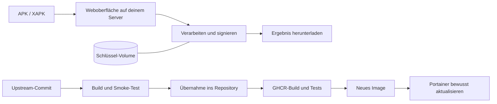

<div align="center">


# 🚘 hAI.AAAPKBuilder

### Dein Server. Dein Build. Deine Schlüssel.

AndroidAutoMaker als selbst gehosteter Docker-/Portainer-Stack.

[](https://github.com/jbkunama1/hAI.AAAPKBuilder/actions/workflows/ghcr.yml)
[](https://github.com/jbkunama1/hAI.AAAPKBuilder/actions/workflows/upstream-sync.yml)
[](LICENSE)
[](docker-compose.yml)

[📖 Projektseite](https://jbkunama1.github.io/hAI.AAAPKBuilder/) · [🐳 Container-Paket](https://github.com/jbkunama1/hAI.AAAPKBuilder/pkgs/container/hai.aaapkbuilder) · [⚙️ Actions](https://github.com/jbkunama1/hAI.AAAPKBuilder/actions) · [🐛 Issues](https://github.com/jbkunama1/hAI.AAAPKBuilder/issues)

</div>

> ℹ️ Die Projektseite ist Dokumentation, kein Online-APK-Konverter. Die Anwendung läuft auf deinem eigenen Docker-Host. Pages muss unter Settings → Pages → Source: GitHub Actions aktiviert sein; der Link ist erst nach erfolgreichem Deployment erreichbar.

## ✨ Was ist enthalten?

| Baustein | Funktion |
|---|---|
| 📦 APK-/XAPK-Workflow | Upload, Verarbeitung und Download über die übernommene Weboberfläche |
| 🐳 Portainer | Stack aus diesem Repository; kein lokaler Image-Build nötig |
| 🔄 Täglicher Abgleich | Neue Upstream-Commits erkennen, Kandidaten bauen und nach Smoke-Test integrieren |
| 🔐 Persistente Schlüssel | Signierschlüssel und Passwortdateien bleiben in einem eigenen Volume |
| 🧪 CI-Prüfungen | Health-Endpunkt und Java-/Android-Toolchain vor Image-Veröffentlichung |
| 🌐 Statische Projektseite | Eigenständige Landingpage ohne Backend oder Uploadfunktion |

Banner und Diagramm sind Projektillustrationen, keine Screenshots. Nicht offizielles Google-Projekt; keine Garantie für Android-Auto-Kompatibilität.

## 🧭 So läuft es ab



## 🚀 Installation mit Portainer

Voraussetzung: Docker Standalone auf Linux amd64/x86_64. ARM64 ist nicht vorgesehen.

1. Unter [Actions](https://github.com/jbkunama1/hAI.AAAPKBuilder/actions) einen erfolgreichen GHCR-Build abwarten. Der erste Workflow importiert die Vorlage nach `upstream/`.
2. GHCR-Paketsichtbarkeit prüfen: Für anonymen Pull muss das Paket öffentlich sein. Alternativ Registry-Zugang mit `read:packages` in Portainer hinterlegen.
3. Portainer → Stacks → Add stack → Repository.
4. Diese Werte eintragen:

| Einstellung | Wert |
|---|---|
| Repository URL | `https://github.com/jbkunama1/hAI.AAAPKBuilder` |
| Reference | `refs/heads/main` |
| Compose path | `docker-compose.yml` |
| Image | `ghcr.io/jbkunama1/hai.aaapkbuilder:latest` |

5. Für LAN-Zugriff `BIND_IP` auf die konkrete LAN-IP des Docker-Hosts setzen. Stack deployen und `http://HOST-IP:4173` öffnen.

### 🎛️ Stack-Variablen

| Variable | Standard | Zweck |
|---|---|---|
| `BIND_IP` | `127.0.0.1` | Standardmäßig nur am Docker-Host erreichbar; für LAN die Host-LAN-IP setzen |
| `APP_PORT` | `4173` | Veröffentlichter Host-Port |
| `IMAGE_TAG` | `latest` | Beweglicher Stand oder fester Versions-/sha-Tag |

Für einen Reverse-Proxy-Container eine passende gemeinsame Netzwerkverbindung einrichten; dessen localhost ist nicht der Builder. Der Stack verwendet kein externes Netzwerk voraussetzungslos.

### 💻 Alternativ per CLI

```bash
git clone https://github.com/jbkunama1/hAI.AAAPKBuilder.git
cd hAI.AAAPKBuilder
# Nur für LAN-Zugriff: BIND_IP durch die tatsächliche Host-LAN-IP ersetzen.
# Ohne diese Variable bleibt die Bindung lokal.
docker compose up -d
docker compose ps
```

## 🔄 Automatische Upstream-Updates

`Daily upstream sync` prüft täglich um 03:37 UTC (04:37 MEZ / 05:37 MESZ) den HEAD des Standardbranches von [malebuffy/AndroidAutoMaker](https://github.com/malebuffy/AndroidAutoMaker). Es werden Commits verfolgt, nicht nur Releases. Zeitpläne können verzögert werden; GitHub kann sie in inaktiven öffentlichen Repositorys nach 60 Tagen deaktivieren.

- Neue Stände ersetzen den Inhalt von `upstream/`, einschließlich entfernter Dateien. Eigene Änderungen dort werden überschrieben.
- Dockerfile, Stack und eigene Workflows außerhalb dieses Verzeichnisses bleiben erhalten.
- Erst nach erfolgreichem Kandidaten-Build und Smoke-Test erfolgt der Commit auf main. Eine veränderte Lizenzdatei stoppt die Übernahme.
- Danach startet der GHCR-Workflow ausdrücklich, testet erneut und veröffentlicht `latest` sowie den sha-Tag. Git-Tags mit Präfix `v` erhalten entsprechende Image-Tags.
- Bei fehlgeschlagenen Tests wird kein neues Image veröffentlicht. Smoke-Tests ersetzen keinen realen APK-Praxistest.

Manuell: Actions → Daily upstream sync → Run workflow (main). Die Automation braucht `contents:write`, `actions:write` und erlaubte Pushes auf main; der GHCR-Build zusätzlich `packages:write`. Regeln werden nicht umgangen. Details: [DAILY_UPSTREAM.md](DAILY_UPSTREAM.md).

> 📌 Ein neues GHCR-Image aktualisiert keinen laufenden Container. In Portainer den Stack mit erneutem Image-Pull aktualisieren.

```bash
docker compose pull
docker compose up -d
```

## 🔐 Daten und Backup

| Volume | Containerpfad | Inhalt |
|---|---|---|
| `aaapk_keys` | `/app/tools/keys` | Private Signierschlüssel und zugehörige Passwortdateien |
| `aaapk_work` | `/app/work` | Temporäre Jobs und Ausgaben |
| `aaapk_framework` | `/app/tools/framework` | Framework-Cache |

Compose ergänzt normalerweise den Stacknamen vor den Volume-Namen. Für konsistente Backups Container stoppen, Volumes sichern und bei Wiederherstellung UID/GID 1000 erhalten. Schlüssel und Passwortdateien gemeinsam sichern und nie committen. Schlüsselverlust kann spätere Update-Installationen verhindern.

Jobstatus liegt zusätzlich im RAM; Neustarts setzen laufende Jobs zurück. Upstream bereinigt abgeschlossene Jobs zeitabhängig. `docker compose down -v` löscht Volumes und ist kein Updatebefehl.

## 🛡️ Sicherheit und Grenzen

- Keine allgemeine Benutzeranmeldung: nicht ungeschützt ins Internet stellen. Fernzugriff nur über VPN oder authentifizierenden HTTPS-Proxy.
- Nur vertrauenswürdige APKs verarbeiten, für die du die nötigen Rechte hast. Das Dekodieren fremder Archive ist nicht risikofrei.
- Non-root-Laufzeit als node (UID 1000), ohne privileged, Docker-Socket oder USB-Freigabe. Standard: 2 GiB Containerlimit und 1 GiB Java-Heap.
- Die optionale ADB-Telefoninstallation braucht eine gesonderte Server-/Container-Verbindung. Ein Telefon am Browser-Client ist nicht automatisch verbunden.
- Die ursprüngliche Oberfläche sowie Navigation-/Spendenfunktionen und deren Konfigurationsanforderungen bleiben erhalten; Zahlungsdaten werden nicht eingerichtet.
- Nur im geparkten Fahrzeug testen. Keine ablenkenden Anwendungen während der Fahrt verwenden.

## 🧰 Fehlerdiagnose

| Problem | Prüfen |
|---|---|
| Image nicht gefunden | Erfolgreichen Actions-Build, Image-Namen und Tag |
| Denied / Unauthorized | GHCR-Sichtbarkeit bzw. Registry-Anmeldung |
| Verbindung scheitert | `BIND_IP`, Host-Port und Firewall |
| Permission denied | Schreibrechte der Volumes für UID 1000 |
| Unhealthy | Containerlogs und `/api/health` |
| Sync scheitert mit 403 | Actions-Rechte, Branch-Schutz und Organisationsrichtlinien |
| Speicherfehler | Logs prüfen, dann Containerlimit und Java-Heap gemeinsam anpassen |

```bash
docker compose logs --tail=100 aaapkbuilder
docker compose ps
```

Lokaler Build nach Quellimport: `docker build -t hai-aaapkbuilder .`

## 🌐 GitHub Pages

Die responsive Projektseite liegt in `docs/index.html`, das gemeinsame Banner in `docs/assets/banner.svg`. Der Pages-Workflow veröffentlicht ausschließlich `docs/`, nicht den Anwendungsserver. Unter Settings → Pages als Quelle GitHub Actions wählen. Nach erfolgreichem Deployment ist die Seite unter `https://jbkunama1.github.io/hAI.AAAPKBuilder/` vorgesehen. Die Pages-Einstellung wird durch diesen Commit nicht separat per API umgestellt.

## 🙏 Herkunft und Lizenz

Grundlage: [AndroidAutoMaker von malebuffy](https://github.com/malebuffy/AndroidAutoMaker). Der importierte Quellstand ist in [UPSTREAM.txt](UPSTREAM.txt) dokumentiert. Originaldateien und Lizenzhinweise bleiben unter `upstream/` erhalten; Fremdkomponenten behalten ihre jeweiligen Lizenzen. Dieses Projekt ergänzt Containerisierung, CI und Dokumentation, nicht die Urheberschaft der Vorlage. Lizenz: [GPL-3.0-only](LICENSE). Kein offizielles Google-/Android-Auto-Angebot.

## 🧪 Prüfstatus

Die Badges zeigen den jeweiligen Workflowstatus und sind kein Sicherheitszertifikat. Ein erfolgreicher Image-Build, ein Deployment auf deinem Host und ein realer APK-Konvertierungstest sind getrennte Prüfschritte. Diese Dokumentationsänderung behauptet keinen erfolgreichen Praxistest.
